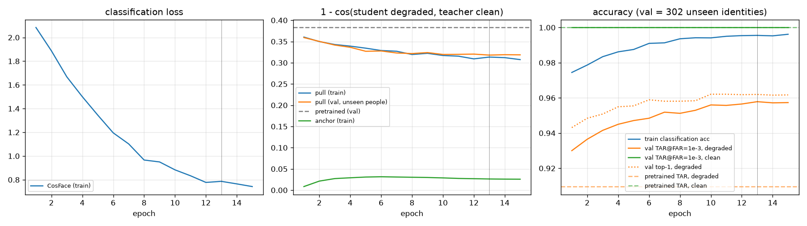
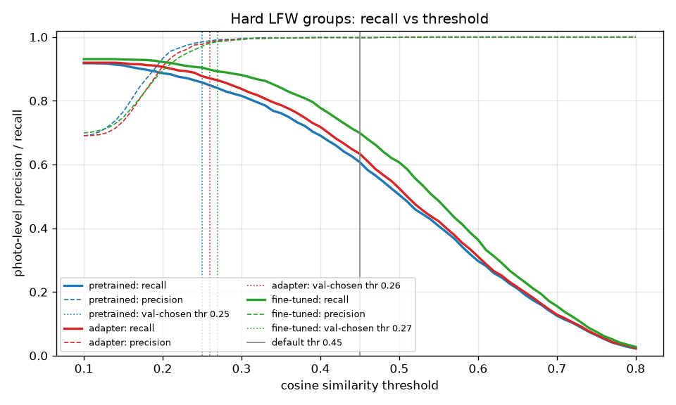

# Group Photo Tagger (CSCI 566)

Finds every face in a group photo and labels who it is ("A and B are in this photo"),
or "unknown" for people not enrolled. Photos can also be searched by person and by CLIP scene tag.

```
photo ─► SCRFD detector ─► 5-point alignment (112×112) ─► face embedder ─► 512-d embedding
                                                                              │
gallery (avg embedding per person) ─────────────── cosine similarity + Hungarian match ─► name / unknown
```

Adding a new person = dropping a few photos in a folder and re-running `enroll`. No retraining.

The project has two parts that share the detector, alignment, matching and benchmark code but
use different face embedders:

- **[Part A](#part-a-pretrained-pipeline-fine-tuning-speed-hooman)** (repo root): the full
  tagger on pretrained InsightFace `buffalo_l` (ArcFace R50), made 3.3× faster with batching,
  prefetching and TensorRT FP16, plus scene tags, a demo, and a hard (degraded) benchmark where an
  embedding adapter and a fine-tuned ArcFace are compared with thresholds chosen on held-out people.
- **[Part B](#part-b-embedder-trained-from-scratch-ablations-hard-cases-parth-muley)**
  ([`scratch_embedder/`](scratch_embedder/README.md)): an IR-ResNet-34 embedder trained from
  scratch with ArcFace loss on CASIA-WebFace, ablations, hard-case study and quality-augmentation
  fix, and an end-to-end test inside the Part A tagger.

## Part A: pretrained pipeline, fine-tuning, speed (Hooman)

### Setup

```bash
pip install -r requirements.txt
# GPU (RTX 5090): swap in onnxruntime-gpu + its CUDA 13/cuDNN 9 runtime wheels, then add --gpu
pip uninstall -y onnxruntime && pip install "onnxruntime-gpu[cuda,cudnn]"
# optional, for --trt (TensorRT FP16). onnxruntime-gpu 1.31 is built against TensorRT 10, not 11
pip install "tensorrt-cu13==10.16.1.11"
# scene tags (CLIP) + demo. CPU torch on purpose: CLIP runs on the GPU through onnxruntime,
# and a CUDA torch build would bring its own CUDA 13 libraries that can clash with onnxruntime's
pip install torch torchvision --index-url https://download.pytorch.org/whl/cpu
pip install open_clip_torch onnxscript gradio
```
`--trt` builds FP16 engines on first use (~45 s) and caches them in `trt_cache/`; later runs load
in ~1.5 s. Any script that creates GPU sessions itself must call `onnxruntime.preload_dlls()`
first, otherwise onnxruntime silently falls back to CPU (`tagger.load_models` does this).
Pretrained models (`buffalo_l`) download automatically to `~/.insightface/models` on first run.

### Usage

```bash
# 1. enroll: data/gallery/<person_name>/*.jpg  (3-10 clear photos each is ideal)
python tagger.py enroll --gallery data/gallery --out gallery.npz

# 2. tag one photo -> prints who's in it, writes photo_tagged.jpg
python tagger.py tag --image some_group_photo.jpg

# 3. evaluate on labeled photos (data/test + data/test_labels.csv), with threshold sweep
python tagger.py eval
```

### No data? Generate a benchmark

`make_groups.py` builds hundreds of labeled synthetic group photos from LFW (13k photos of
5.7k people, downloaded automatically by scikit-learn). It holds out ~30% of people as
**distractors** so the model is also tested on saying "unknown". With the default
`--min-faces 10` that is 158 people (111 enrolled, 47 distractors).

```bash
python make_groups.py --source lfw --out data/lfw_groups --n-groups 500 --gpu
python tagger.py enroll --gallery data/lfw_groups/gallery --out data/lfw_groups/gallery.npz
python tagger.py eval --gallery-file data/lfw_groups/gallery.npz \
    --test-dir data/lfw_groups/test --labels data/lfw_groups/test_labels.csv \
    --out-dir data/lfw_groups/outputs --gpu
```

Metrics are photo-level: precision/recall over "who is in this photo", and exact-match rate
(the predicted set of people is exactly right).

### Find one person across an album

```bash
python search.py --person data/gallery/obama --photos data/test --gpu
```
Writes boxed copies of matching photos to `results/matches/` and every photo's best
similarity to `results/results.csv`. Album embeddings are cached, so later searches are
instant; add `--no-cache` to force re-indexing (e.g. for timing). `--trt` uses TensorRT FP16,
and `--profile results/profile.md` appends a ms/photo breakdown per stage (decode, detection
pre/infer/post, alignment, embedding, scene, overhead).

#### Person + scene
Every photo also gets zero-shot scene tags from CLIP ViT-B/32 (open_clip, LAION-2B weights),
stored in the album cache next to the face embeddings:

```bash
python search.py --person data/gallery/obama --scene stage --photos data/test --gpu   # person AND scene
python search.py --scene concert indoor --photos my_album/ --gpu                      # scene only
```
Labels: concert, beach, jungle/forest, wedding, restaurant, office, street, stage, sports event,
party, plus indoor/outdoor. Several `--scene` labels must all apply. "indoor"/"outdoor" get their
own softmax because they aren't alternatives to "concert" (a concert is also indoor or
outdoor). A photo's tags are up to 2 scenes with probability ≥ 0.3 (`--scene-min-p`), plus
indoor or outdoor. `results.csv` has a `scenes` column.

- **GPU:** the image encoder is exported once to ONNX (`clip_cache/`, ~350 MB). It runs on
  onnxruntime CUDA (after `preload_dlls()`), or as a TensorRT FP16 engine with `--trt`.
  Embeddings match open_clip exactly (cosine 1.00000). TensorRT FP16 has cosine ≥ 0.9998, and
  1 of 205 photos had its tag set change (a label right at the 0.3 cutoff).
- **Speed:** CLIP resize/crop runs in the prefetch thread with the JPEG decode. With `--trt`,
  tagging adds about 2 ms/photo to indexing. `--no-scenes` skips it.
- **Cache:** if an existing cache was built without scene tags, or with other labels, only the
  CLIP step re-runs. Faces are not re-detected.
- **Caveat:** no scene-labeled benchmark yet; tags are only spot-checked on the sample photos
  (`office`, `street`, `party`, `stage`).

### Demo

```bash
python demo.py --gallery-file gallery.npz --gpu        # http://127.0.0.1:7860
```
Upload a photo to get the faces boxed and named, plus scene tags and CLIP scene probabilities.
A slider sets the face threshold. It also takes `--trt`, `--adapter` (with a gallery enrolled
using the same adapter) and `--share`.

### Results so far

LFW groups benchmark: 500 synthetic group photos (2–8 faces each), 111 enrolled people, 47
distractors, buffalo_l (SCRFD-10G + ArcFace R50), default threshold **0.45**.

| Precision | Recall | F1 | Photos fully correct |
|---|---|---|---|
| 0.999 | 0.997 | 0.998 | 98.8% (494 / 500) |

**Threshold sweep** (cosine similarity). 0.42–0.45 tie for best, and recall starts to drop at 0.48:

| thr | precision | recall | F1 | exact |
|---|---|---|---|---|
| 0.15 | 0.767 | 0.999 | 0.868 | 0.330 |
| 0.20 | 0.917 | 0.999 | 0.956 | 0.732 |
| 0.25 | 0.977 | 0.998 | 0.988 | 0.918 |
| 0.30 | 0.989 | 0.997 | 0.993 | 0.956 |
| 0.35 | 0.996 | 0.997 | 0.996 | 0.978 |
| 0.40 | 0.998 | 0.997 | 0.997 | 0.986 |
| **0.45** | **0.999** | **0.997** | **0.998** | **0.988** |
| 0.50 | 0.999 | 0.994 | 0.996 | 0.978 |
| 0.55 | 0.999 | 0.983 | 0.991 | 0.942 |
| 0.60 | 0.999 | 0.954 | 0.976 | 0.842 |
| 0.65 | 0.999 | 0.905 | 0.950 | 0.700 |
| 0.70 | 0.999 | 0.782 | 0.877 | 0.452 |

#### Benchmark fix: blurring bystanders
The first run scored 0.986 precision and 94.6% fully correct photos. Most of those "false
positives" were actually correct answers. Many LFW photos contain other people besides the
labeled one (George W. Bush kissing Laura Bush, Erdoğan next to Gül, Colin Powell in the
background). The model recognized them correctly, but the label lists only the main person, so
each one counted as an error: 22 of the 25 false positives were bystanders like these.

`make_groups.py` now detects every face in each source photo before tiling and heavily blurs
all faces except the main one (largest face, weighted toward the centre). Detection runs over
several paddings and scales and merges the results, because a single pass missed faces cut off
at the photo's edge and small background faces. The random seed still produces the same 500
groups, so before and after compare directly. Use `--keep-bystanders` to get the old behaviour.

#### Remaining errors (6 photos)
- **4 real misses:**
  - **Nicole Kidman (×3):** all three of her gallery photos are blonde red-carpet shots, but her
    test photos are dark-haired film stills (similarity 0.24–0.28). This needs more varied
    gallery photos; changing the threshold won't fix it.
  - **Saddam Hussein (×1):** sunglasses and a blurry photo, similarity 0.37.
- **2 likely LFW labeling problems:** the photo labeled Michael Schumacher shows a face that
  looks like Rubens Barrichello, and in the photo labeled Erdoğan the centred face is Gül.

#### Speed: CPU vs GPU (RTX 5090)
Detection + embedding, from `search.py --no-cache` on 200 photos with 1–3 faces each:

| | photos/s | ms/photo |
|---|---|---|
| CPU | 13.9 | 71.8 |
| GPU (CUDA, onnxruntime-gpu) | 44.5 | 22.5 |

#### Speed-ups on LFW groups (RTX 5090)
`search.py --no-cache` indexing of the 500 LFW group photos (5.0 faces/photo on average). Each row
adds one change. photos/s is the median of 3 runs, and the stage breakdown comes from `--profile`
(full tables in [docs/profile.md](docs/profile.md)):

| step | photos/s | ms/photo | det_infer | embed | decode | flag to turn it off |
|---|---:|---:|---:|---:|---:|---|
| baseline: CUDA, one ArcFace call per face | 36.3 | 27.5 | 4.4 | 17.2 | 1.6 | `--no-batch --no-prefetch` |
| (a) all faces of a photo in one ArcFace call | 65.0 | 15.7 | 4.6 | 5.4 | 1.6 | `--no-prefetch` |
| (b) + decode next images on a background thread | 71.3 | 13.8 | 4.2 | 5.2 | 0.1 | (default with `--gpu`) |
| (c) + TensorRT EP, FP16, engine cache | **118.1** | **8.2** | 1.7 | 2.5 | 0.1 | (`--trt`) |

Accuracy is unchanged with every step: CUDA and TensorRT FP16 both give precision 0.999, recall
0.997, F1 0.998 and exact match 0.988 at threshold 0.45, with the same 6 error photos.

- **Batching needs a fixed shape.** Plain batching made ArcFace *slower* (28 ms/photo):
  onnxruntime's CUDA EP re-plans its cuDNN convolutions whenever the batch size changes, and the
  face count changes every photo. Zero-padding every call to 16 faces (`fastpath.EMBED_BATCH`)
  costs 4.2 ms per call, versus 2.9 ms for one face alone.
- **TensorRT** gets one fixed-shape engine per model (detector 1×3×640×640, ArcFace 16×3×112×112).
  insightface's own fixed-size detector session copies provider options back out of ORT, which
  breaks for TensorRT and silently falls back to CUDA, so `load_models` builds both sessions itself.
- **What's left:** CPU work (resize/normalize 2.1 ms, alignment 1.1 ms, NMS 0.5 ms) is now ~45% of
  the time. Next steps are moving it to the prefetch thread or the GPU, and batching across photos.

### Hard photos: embedding adapter vs fine-tuned ArcFace

**Hard benchmark.** `make_groups.py --hard` builds `data/lfw_groups_hard`, which has the same 500
groups, layout and labels as the clean benchmark. Every face tile gets a random mix of gaussian
blur, downscaling to a 24–48 px face, sunglasses or mask occlusion, low light, and JPEG
compression (`degrade.py`). The gallery stays clean. On it, the detector finds 2,381 of the 2,511
faces, so about 5% are missed before recognition even starts.

**Training data.** Both models train only on LFW people that cannot appear in the benchmark.
The benchmark uses everyone with ≥ 10 photos (enrolled and distractors), so training uses the
other 5,591 people (8,909 photos). The scripts also check against the benchmark galleries and
labels, and stop on any overlap. 302 of those people with ≥ 2 photos are held out entirely as
**validation people**, and checkpoints, hyperparameters and thresholds are picked on them. The
benchmark is used only for the final table.

**The two models:**
- **Adapter** (`train_adapter.py`, `--adapter models/adapter.npz`): a residual MLP on the frozen
  512-d ArcFace embedding, initialised as the identity. It trains on cached embeddings of clean
  photos and 24 degraded versions of each, with a loss that pulls degraded embeddings toward
  their clean embedding, plus an anchor that keeps clean embeddings in place. Twelve
  configurations were tried, with CosFace weight 0–1, pull weight 1–4, hidden size 256–1024,
  dropout, weight decay, and 8 vs 24 degradations per photo. All of them stopped between 0.915
  and 0.922 degraded TAR@FAR=1e-3 on validation (pretrained: 0.909). With CosFace on, the MLP
  memorises the training identities. The one picked has hidden size 256, dropout 0.5, and no
  CosFace term. Curves: [docs/adapter_curves.png](docs/adapter_curves.png).
- **Fine-tuned** (`finetune_data.py` + `train_finetune.py`, `--model models/arcface_r50_ft.onnx`):
  the ArcFace R50 ONNX is converted to PyTorch with onnx2torch (max difference vs onnxruntime
  1e-6). Stem, stage 1 and stage 2 are frozen, and stages 3–4 plus the embedding head are trained
  (42.2M of 43.6M params) on CUDA. Each step degrades the photo on the fly with the same
  generator, using a small alignment jitter. The loss is CosFace over 5,276 identities (weights
  start at each identity's pretrained mean embedding), plus a pull of degraded embeddings toward
  the frozen original model's clean embedding, plus an anchor on clean embeddings. BatchNorm
  stays frozen. Training only stage 4 reached 0.938 validation TAR; stages 3–4 reached **0.958**
  (epoch 13 of 15, about 17 s per epoch on the RTX 5090). The model is exported back to ONNX.
  Curves: [docs/finetune_curves.png](docs/finetune_curves.png).



**Results.** Photo-level metrics on the 500-photo benchmarks. Each model is shown at the
default threshold and at its own threshold. That threshold has the best F1 on the validation
people (clean photos plus degraded versions, equal weight, 30% of the people left out of the
gallery as unknowns), and the same value is used on both benchmarks.

| benchmark | threshold | model | thr | precision | recall | F1 | exact |
|---|---|---|---:|---:|---:|---:|---:|
| clean | default | pretrained | 0.45 | 0.999 | 0.997 | 0.998 | 0.988 |
| clean | default | adapter | 0.45 | 0.999 | 0.997 | 0.998 | 0.988 |
| clean | default | fine-tuned | 0.45 | 0.999 | 0.996 | 0.997 | 0.984 |
| clean | from val people | pretrained | 0.25 | 0.977 | 0.998 | 0.988 | 0.918 |
| clean | from val people | adapter | 0.26 | 0.981 | 0.998 | 0.989 | 0.932 |
| clean | from val people | fine-tuned | 0.27 | 0.985 | 0.997 | 0.991 | 0.942 |
| hard | default | pretrained | 0.45 | 0.998 | 0.607 | 0.755 | 0.236 |
| hard | default | adapter | 0.45 | 0.998 | 0.633 | 0.775 | 0.262 |
| hard | default | fine-tuned | 0.45 | 0.998 | **0.699** | **0.822** | **0.344** |
| hard | from val people | pretrained | 0.25 | 0.985 | 0.857 | 0.917 | 0.578 |
| hard | from val people | adapter | 0.26 | 0.984 | 0.870 | 0.923 | 0.602 |
| hard | from val people | fine-tuned | 0.27 | 0.986 | **0.892** | **0.937** | **0.648** |



Full threshold sweeps for every model and benchmark, and the validation sweep that picked the
thresholds: [docs/model_comparison.md](docs/model_comparison.md) and
[docs/val_threshold_selection.png](docs/val_threshold_selection.png).

- **Fine-tuning helps most on hard photos.** At the same threshold it recovers 9 points of hard
  recall and 11 points of exact match. Recall is higher at every threshold, with no loss of
  precision. The adapter gets about a third of that, because it only sees the 512-d embedding,
  after most of the degradation-specific detail has already been thrown away.
- **Clean accuracy.** At 0.45 the fine-tuned model drops by 0.001 F1 and 2 of 500 photos in
  exact match (0.988 → 0.984). With the thresholds chosen on validation, it is better on clean
  than pretrained (0.942 vs 0.918 exact).
- **Validation thresholds (0.25–0.27) are lower than 0.45** because half the validation weight
  is on degraded faces. They help hard photos a lot and cost clean exact match (0.988 → 0.92–0.94,
  mostly extra false names). 0.45 remains the better choice for clean photo albums.
- **Detector misses.** About 5% of hard faces are never detected, so recall can't reach 1.0
  until the detector improves too.
- **Cross-checks.** `tagger.py eval` with `--model` / `--adapter` reproduces these rows exactly.
  TensorRT FP16 with the fine-tuned model gives the same precision, recall and F1 on hard, and
  0.342 vs 0.344 exact match (one photo).

**Reproduce.** The fine-tuned ONNX is 174 MB, over GitHub's 100 MB file limit, so it isn't in the
repo. Its training settings and validation history are in `models/arcface_r50_ft.json`.
```bash
python make_groups.py --source lfw --out data/lfw_groups_hard --n-groups 500 --hard --gpu
python train_adapter.py --k-degraded 24 --lambda-cls 0 --hidden 256 --dropout 0.5 --wd 0.1 --lr 3e-4 --epochs 12
python finetune_data.py                       # needs results/adapter/embeddings_k8.npz (train_adapter.py --k-degraded 8)
# training venv: CUDA torch is kept out of .venv so it can't clash with onnxruntime-gpu's CUDA libs
python -m venv .venv-train && .venv-train/Scripts/pip install torch torchvision --index-url https://download.pytorch.org/whl/cu130
.venv-train/Scripts/pip install onnx2torch onnx onnxscript opencv-python scikit-image matplotlib scipy
.venv-train/Scripts/python train_finetune.py --stages 2
python compare_models.py                      # table + plots in docs/
python tagger.py enroll --gallery data/lfw_groups/gallery --out data/lfw_groups/gallery_ft.npz --gpu --model models/arcface_r50_ft.onnx
```
Galleries and album caches record which `--model` / `--adapter` produced them. A mismatched
gallery is refused, and `search.py` re-embeds the album when the recognizer changes.

## Part B: embedder trained from scratch, ablations, hard cases (Parth Muley)

Everything for this part is in [`scratch_embedder/`](scratch_embedder/README.md) (imported from
[ParthMuley/snap-ai-face-embedder](https://github.com/ParthMuley/snap-ai-face-embedder) with its
history). It trains its own IR-ResNet-34 with an ArcFace head written from scratch on CASIA-WebFace
(0.49M images, 10,572 people), and plugs it into the Part A tagger in place of ArcFace R50.

**Verification accuracy (%)**:

| | LFW | CFP-FP (pose) | AgeDB-30 (age) |
|---|---|---|---|
| ours (r34, ArcFace, 25 epochs) | 99.30 | 94.29 | 93.23 |
| pretrained buffalo_l | 99.82 | 97.44 | 98.12 |

**Ablations** (2,000-identity subset, 8 epochs, one seed; noise is about ±0.25 on LFW and ±0.5 on
CFP-FP): r18 / r34 / r50, 128-d vs 512-d, and margin 0.3–0.7 all land within noise of each other;
CosFace is slightly lower and plain softmax clearly lower (LFW 94.42 vs 96.48).

**Hard cases** (LFW, probe image degraded): before quality augmentation the model fell to ~82% on
heavy blur, JPEG q=5 and 16 px faces (pretrained: >98%). After a 5-epoch augmentation fine-tune:
blur 98.3, JPEG 95.8, 16 px 91.7. Masks, sunglasses, pose and age gaps are unchanged.

**Group photos** (synthetic LFW groups, same detector and matching, only the embedder differs):

| model | F1 | exact-photo match |
|---|---|---|
| ours (before fix) | 0.989 | 92.3% |
| ours (after fix) | 0.990 | 93.3% |
| pretrained buffalo_l | 0.999 | 99.0% |

> **Not directly comparable to Part A.** This group-photo test used 300 photos (Part A uses 500)
> and picks each model's threshold on the same test photos it is scored on (Part A uses 0.45 or
> thresholds chosen on held-out validation people). Its "pretrained" row also uses flip
> test-time augmentation. Compare rows within this table, not against Part A's tables.

`scratch_embedder/pipeline/group_eval.py` imports the tagger's `tagger.py` / `evaluate.py` from
the repo root by default (`--teammate` still overrides it). Full tables:
[`scratch_embedder/results/`](scratch_embedder/results/); setup and reproduce steps:
[`scratch_embedder/README.md`](scratch_embedder/README.md).

## Model weights

Model weights are not in the repo due to size; available from the team on request.

- **Part A fine-tuned ArcFace** (`models/arcface_r50_ft.onnx`, 174 MB): put it in `models/`.
  The adapter (`models/adapter.npz`) is small and is in the repo. Pretrained `buffalo_l`
  downloads automatically.
- **Part B scratch embedder** (`base_slim.pt`, `aug_slim.pt`, about 140 MB each): put them in
  `scratch_embedder/models/`. Use `aug_slim.pt` (after the quality-augmentation fine-tune).

## Team & contributions

- **Hooman** (Part A, repo root): tagger pipeline and LFW group benchmark (`make_groups.py`,
  bystander blurring), evaluation, album search, speed work (batching, prefetch, TensorRT FP16,
  profiling), CLIP scene tags and Gradio demo, hard benchmark, embedding adapter and ArcFace
  fine-tuning with validation-chosen thresholds.
- **Parth Muley** (Part B, `scratch_embedder/`): IR-ResNet backbone and ArcFace/CosFace heads
  from scratch, CASIA-WebFace training on Colab, ablations, hard-case study and
  quality-augmentation fine-tune, group-photo evaluation of the scratch embedder inside the tagger.

## Roadmap
- [x] Baseline numbers on LFW groups; pick threshold from the sweep (0.45)
- [x] Clean benchmark labels: blur unlabeled bystander faces in LFW source photos
- [ ] Hard cases: small faces, profiles, occlusion — measure each separately
- [ ] More varied gallery photos per person (e.g. Kidman misses)
- [ ] Cluster "unknown" faces across an album (HDBSCAN) so you can name a cluster once
- [x] Train own embedder with ArcFace loss (CASIA-WebFace), compare to pretrained on LFW/CFP-FP
      (Part B, `scratch_embedder/`)
- [x] Throughput benchmark GPU vs CPU (`search.py` timing printout)
- [x] Batch all faces per photo; prefetch decoding; TensorRT FP16 (3.3× faster, same accuracy)
- [ ] TensorRT INT8; move preprocessing off the main thread; batch across photos
- [x] Gradio demo (faces + scene tags)
- [x] CLIP scene tags; person + scene search
- [ ] Scene-labeled photos to measure tag accuracy
- [x] Hard benchmark (blur, low-res, occlusion, low light, JPEG); embedding adapter vs fine-tuned
      ArcFace stages 3–4 (hard F1 0.917 → 0.937 at validation thresholds)
- [ ] Fine-tune / robustify the detector for degraded faces (~5% never detected)

## Data note
Only use photos of people who agreed to it, or public benchmark datasets. The sample
images in `data/` come from the MIT-licensed `ageitgey/face_recognition` repo examples.
